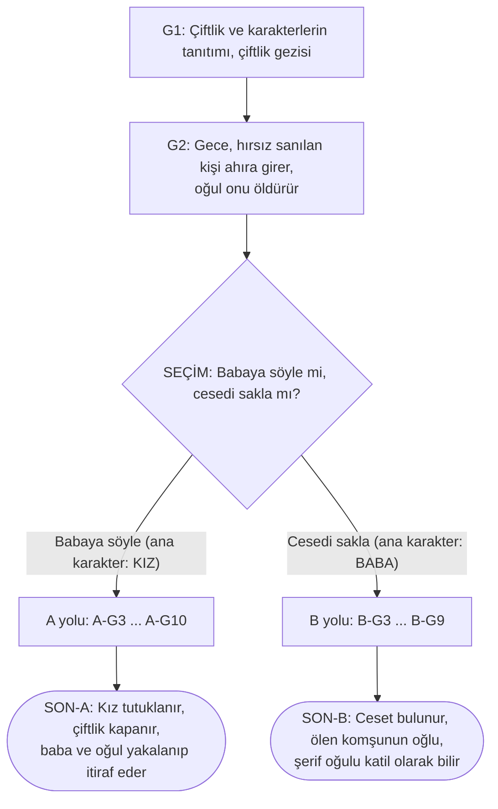
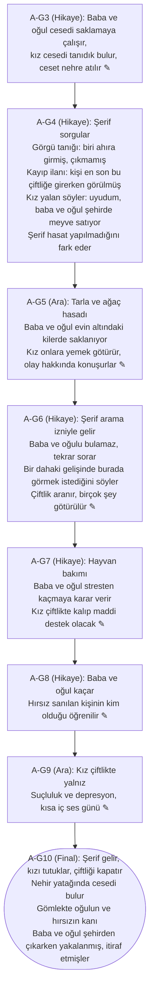
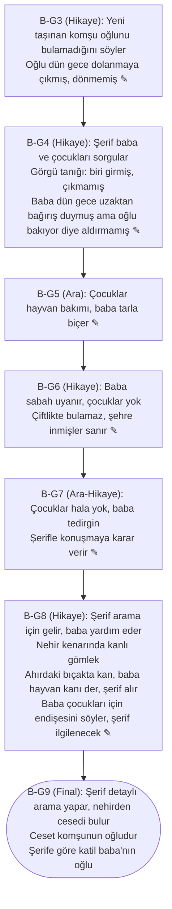

# Akış Şeması (v4: 17 günlük hikâye, ~1 saat)

> Repo yolu: `Docs/Akis-Semasi/akis.md`
> GitHub bu dosyadaki Mermaid şemalarını otomatik çizer.
> Bu sürüm yalnızca verdiğin hikâyeyi şemaya döker. Günlerin arası (✎ ile işaretli) ekipçe doldurulacak.

## Kodlama

| Kod | Anlam |
|---|---|
| `G1`, `G2` | Ortak günler |
| `A-G3` ... `A-G10` | **A yolu**: kız ana karakter (babaya söylendi), 8 gün |
| `B-G3` ... `B-G9` | **B yolu**: baba ana karakter (ceset saklandı), 7 gün |
| `Y1`... | Yan görevler (araları doldururken eklenecek) |
| `D-xx` | Şerif sohbet durakları (araları doldururken eklenecek) |
| ✎ | Bu günün içi ekip tarafından doldurulacak |

Benzersiz gün sayısı: 2 ortak + 8 (A) + 7 (B) = **17 gün**. Tek oynayış: A yolu 10 gün, B yolu 9 gün.

> Not: Metinde oğul bazen "kardeşim", bazen "abim" geçiyor. Şemada tarafsız olarak **"oğul"** yazdım. Tek bir ifadeye karar verilince güncellenecek.

---

## 1) Genel akış

## 2) A yolu (ana karakter: kız)

## 3) B yolu (ana karakter: baba)

---

## Gün tablosu

| Kod | Tip | Özet | Süre |
|---|---|---|---|
| G1 | Tanıtım | Karakterler, çiftlik gezisi | 4 dk |
| G2 | Hikaye + SEÇİM | Hırsız (sanılan), ölüm, ana seçim | 5 dk |
| A-G3 | Hikaye | Ceset tanıdık gelir, nehre atılır | 3 dk |
| A-G4 | Hikaye | Şerif sorgusu, kızın yalanı, hasat ipucu | 5 dk |
| A-G5 | Ara | Hasat, kilere yemek, sohbet | 3 dk |
| A-G6 | Hikaye | Arama izni, eşyalar götürülür | 5 dk |
| A-G7 | Hikaye | Hayvan bakımı, kaçma kararı | 3 dk |
| A-G8 | Hikaye | Baba ve oğul kaçar, hırsızın kimliği | 4 dk |
| A-G9 | Ara | Yalnızlık, kısa iç ses | 2 dk |
| A-G10 | Final | Tutuklama, ceset, itiraf | 5 dk |
| B-G3 | Hikaye | Komşunun kayıp oğlu | 3 dk |
| B-G4 | Hikaye | Şerif sorgusu | 4 dk |
| B-G5 | Ara | Hayvan bakımı, biçme | 2 dk |
| B-G6 | Hikaye | Çocuklar kayıp | 3 dk |
| B-G7 | Ara-Hikaye | Şerife gitme kararı | 3 dk |
| B-G8 | Hikaye | Arama, gömlek, bıçak | 5 dk |
| B-G9 | Final | Ceset, komşunun oğlu, oğul katil | 5 dk |

Tek oynayış: A yolu yaklaşık 39 dk, B yolu yaklaşık 34 dk. Toplam benzersiz içerik yaklaşık **64 dk**.

---

## Bayrak tablosu (GameState)

Hikâye doğrusal olduğu için bayrakların çoğu süreklilik ve epilog metni içindir. Tek gerçek seçim G2'dedir.

| Bayrak | Nerede set edilir | Kullanıldığı yer |
|---|---|---|
| `baba_biliyor` | G2 seçimi | Yol seçimi (true: A, false: B) |
| `ceset_nehirde` | A-G3 / G2 (B) | A-G10, B-G9 |
| `hirsiz_komsu_cocugu` | G2 (gerçek durum, oyuncu bilmez) | A-G8, B-G3, B-G9 |
| `kiz_serife_yalan_soyledi` | A-G4 | A-G6 şerifin tavrı |
| `serif_hasat_fark_etti` | A-G4 | A-G5'te kızın hasadı yapma nedeni |
| `baba_oglan_kilerde` | A-G5 | A-G6 arama sahnesi |
| `arama_yapildi` | A-G6, B-G8 | Eşyalar götürülür |
| `serif_dedi_gelince_burada_gormek` | A-G6 | A-G7 kaçma kararı |
| `baba_oglan_kactı` | A-G8 | A-G9, A-G10 |
| `hirsiz_kimligi_ogrenildi` | A-G8 | A-G9 depresyon |
| `cocuklar_gitti` | B-G6 | B-G7, B-G9 |
| `baba_bicak_yalani` | B-G8 | B-G9 finali |
| `gomlek_bulundu` | B-G8 | B-G9 kanıtı |
| `bicak_serifte` | B-G8 | B-G9 kanıtı |
| `ceset_bulundu` | A-G10, B-G9 | Final |

---

## Kanıt zinciri (iki final de aynı sahneye çıkar)

| Kanıt | A yolunda | B yolunda |
|---|---|---|
| Ceset | Nehir yatağında bulunur (A-G10) | Nehirden çıkar (B-G9) |
| Kanlı gömlek | Oğulun ve hırsızın kanı | Nehir kenarında bulunur (B-G8), oğulun kanı |
| Bıçak | Götürülen eşyalar arasında | Ahırda, "hayvan kanı" yalanı (B-G8) |
| İtiraf | Baba ve oğul şehirden çıkarken yakalanıp itiraf eder | Oğul katil olarak anlatılır |

---

## Araları doldururken dikkat edilecekler

- [ ] **G2:** Ölen kişiye dair küçük ipuçları gerekir (silahsız, ahırda atlara bakıyor gibi), yoksa A-G8 ve B-G9'daki sürpriz ucuz kalır.
- [ ] **Kardeş/abi:** Tek ifadeye karar verin.
- [ ] **A-G8:** Kızın hırsızın kimliğini nasıl öğrendiği boş. Çit başında komşuyla bir sahne ya da bir mektup olabilir.
- [ ] **B yolu çocukları:** B-G6'dan B-G9'a kadar çocukların nerede olduğu belirsiz. Oğulun suçu üstlenmesi için bir sahne ya da diyalog gerekebilir.
- [ ] **B-G7:** Harita büyümeyeceği için "şerife gitmek" çiftlik içinde bir sahne olarak çözülmeli.
- [ ] **A-G9:** Kısa tutun, tekrarlayan görev yerine iç ses ve atmosfer kullanın.
- [ ] **Şerif karakteri:** Dört sorgu/arama sahnesinde (A-G4, A-G6, B-G4, B-G8) şerif ana karakter, bu sahneler "Şerif Eşlik Sahnesi" gibi tek bir tekrar kullanılabilir sistemle yapılabilir.
